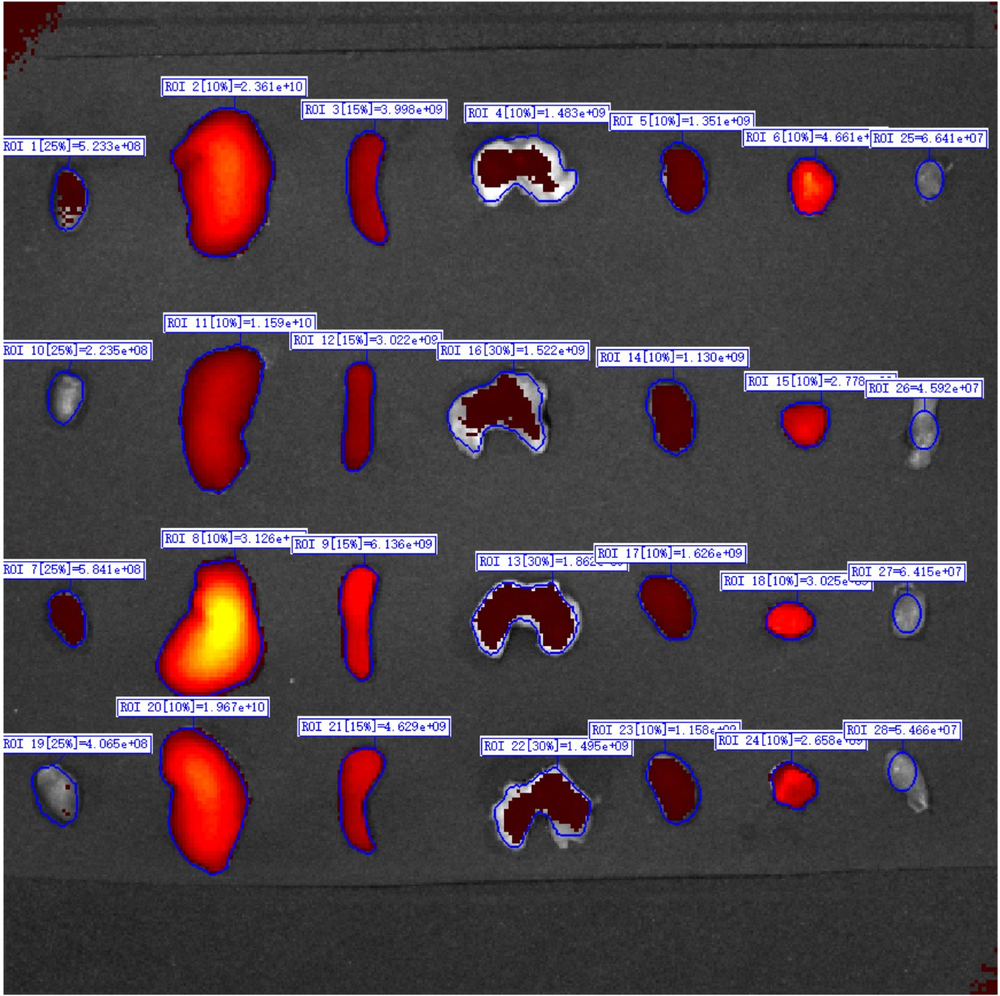

# Auto Living Image Skill

English · [简体中文](README.zh-CN.md)

A shared skill for **Codex** and **Claude Code** that guides desktop ROI measurement in Living Image (IVIS) and records the results in Excel. It covers ex vivo organ ROIs, in vivo tumor ROIs, and an optional GraphPad Prism XY export. The desktop workflow was exercised on Windows with Living Image 4.3.1.

## Workflow examples

### 1. Ex vivo organ quantification

**Confirm the sample layout → Trace organ ROIs with irregular Auto 1 → Match values in ROI Measurements → Write and verify one Excel row per mouse and tissue**

| Original fluorescence image | Previously completed ROI overlay |
| --- | --- |
|  |  |

The completed overlay shows **28 ROIs across four mice** from the same 48 h acquisition. Each row is one mouse. From left to right, the columns are heart, liver, spleen, lung, kidney, tumor, and muscle. The agent checks the ROI against its position and uses tissue-specific thresholds. If the signal is too weak for Auto 1, the agent asks whether to use a manual ROI or leave the value blank. [Organ ROI settings and workflow](living-image-roi/references/organ-roi.md)

### 2. In vivo tumor quantification


*Actual Living Image capture showing three tumor ROIs. The overlay labels show totals. For averages, use the Avg Radiant Efficiency column in ROI Measurements.*

| Living Image | Excel |
| --- | --- |
|  |  |
| **ROI Tools → Auto 1** | Example output with synthetic values |

## Install

Download or clone this repository. Copy the entire [living-image-roi](living-image-roi/) folder into your client's skills directory.

| Client | Personal skills directory | Invoke |
| --- | --- | --- |
| [Codex](https://learn.chatgpt.com/docs/build-skills) | `~/.agents/skills/` | `$living-image-roi` |
| [Claude Code](https://code.claude.com/docs/en/skills) | `~/.claude/skills/` | `/living-image-roi` |

Use a local Windows session with a desktop control tool available to the agent. Python 3 and `openpyxl` are required only for the optional Prism export.

## Run a measurement

### You open

1. Open **Living Image** and load the dataset list in its **Browser**. The agent selects the individual images.
2. Open **Excel** and the workbook you want filled, either a blank workbook or an existing results file. Grant desktop access to the two apps if the client prompts.

### You tell the agent

- **What to measure.** Give the dataset or the group, time point, and mouse IDs. Specify the target (tumor or organs) and how mice and organs are arranged if their order is unclear.
- **Which settings to use.** Give the exposure, ROI method and threshold, and metric if your protocol specifies them. For a new in vivo fluorescence run, the skill defaults to the first fluorescence image, circular Auto 1 at 50%, Binning 2, no smoothing, and Avg Radiant Efficiency.
- **Where results go.** Name the destination worksheet if the workbook has several. Say whether to save new ROIs to the dataset or leave them open for review.

> Measure the ex vivo ROIs for Demo A at 48 h. Mouse IDs 1–4 run from top to bottom. The columns from left to right are heart, liver, spleen, lung, kidney, tumor, and muscle. Use the example Auto 1 thresholds and ask before drawing manual ROIs. Read Avg Radiant Efficiency from ROI Measurements. Append the results to Sheet1 in the open Excel workbook and save it. Leave the ROIs open for review.

### The agent does

1. **Find the image.** Match the requested dataset in the Browser, open the right exposure, and confirm the image ID and mouse order.
2. **Measure the ROIs.** Check existing contours or apply the requested settings and draw new ones. Open **Measure ROIs**, read the requested column, and match each value to the correct animal or organ. Flag an ambiguous target for review.
3. **Record and verify.** Append the measurements, units, and image IDs to the confirmed Excel sheet. Check the written rows against the measurement table and follow your save instructions.

## Prism export

From the repository root, run the helper on a saved copy of the in vivo workbook. It creates a TSV with time points as rows and mouse replicates grouped by column. Paste it into a new sheet at A1, save, then run the check against the saved workbook. Sheet indexes start at zero.

```sh
python -m pip install openpyxl
python living-image-roi/scripts/wide_table.py build results.xlsx prism.tsv
python living-image-roi/scripts/wide_table.py check results.xlsx --wide-sheet 1
```

## License

[GNU General Public License v3.0](LICENSE) covers this project's skill, script, and documentation. Living Image, Excel, and GraphPad Prism are separate products.
