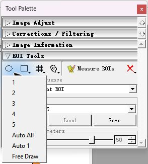
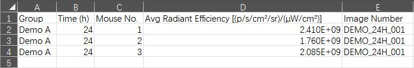

# Auto Living Image Skill

English · [简体中文](README.zh-CN.md)

A shared skill for **Codex** and **Claude Code** that guides desktop ROI measurement in Living Image (IVIS) and records the results in Excel. It covers in vivo tumor ROIs, ex vivo organ ROIs, and an optional GraphPad Prism XY export. The desktop workflow was exercised on Windows with Living Image 4.3.1.

## Install

Download or clone this repository. Copy the entire [living-image-roi](living-image-roi/) folder into your client's skills directory.

| Client | Personal skills directory | Invoke |
| --- | --- | --- |
| [Codex](https://learn.chatgpt.com/docs/build-skills) | `~/.agents/skills/` | `$living-image-roi` |
| [Claude Code](https://code.claude.com/docs/en/skills) | `~/.claude/skills/` | `/living-image-roi` |

Open Living Image, load the dataset list, and open the target workbook. The agent session needs a desktop control tool with access to those apps. Python 3 and `openpyxl` are required only for the optional Prism export.

## Quick start

> Measure the tumor ROIs for Demo A at 24 h, mice 1–3, from left to right. Use the first fluorescence image, circular Auto 1 at 50%, Binning 2, and no smoothing. Append Avg Radiant Efficiency and the image ID to the open Excel workbook. Leave the dataset open for review.

1. **Load the image.** Expand the matching sequence in the Living Image Browser and open the agreed image.
2. **Measure.** In **Tool Palette → ROI Tools**, choose **Auto 1** from the circular ROI menu. Verify each contour against the intended target, then open **Measure ROIs**.

   

3. **Record.** Append one row per mouse to Excel, keeping the ROI metric, units, and source image ID together. The Excel screenshot contains synthetic example values.

   

## Prism export

From the repository root, run the helper on a saved copy of the in vivo workbook. It creates a TSV with time points as rows and mouse replicates grouped by column. Paste it into a new sheet at A1, save, then run the check against the saved workbook. Sheet indexes start at zero.

```sh
python -m pip install openpyxl
python living-image-roi/scripts/wide_table.py build results.xlsx prism.tsv
python living-image-roi/scripts/wide_table.py check results.xlsx --wide-sheet 1
```

## License

[GNU General Public License v3.0](LICENSE) covers this project's skill, script, and documentation. Living Image, Excel, and GraphPad Prism are separate products.
