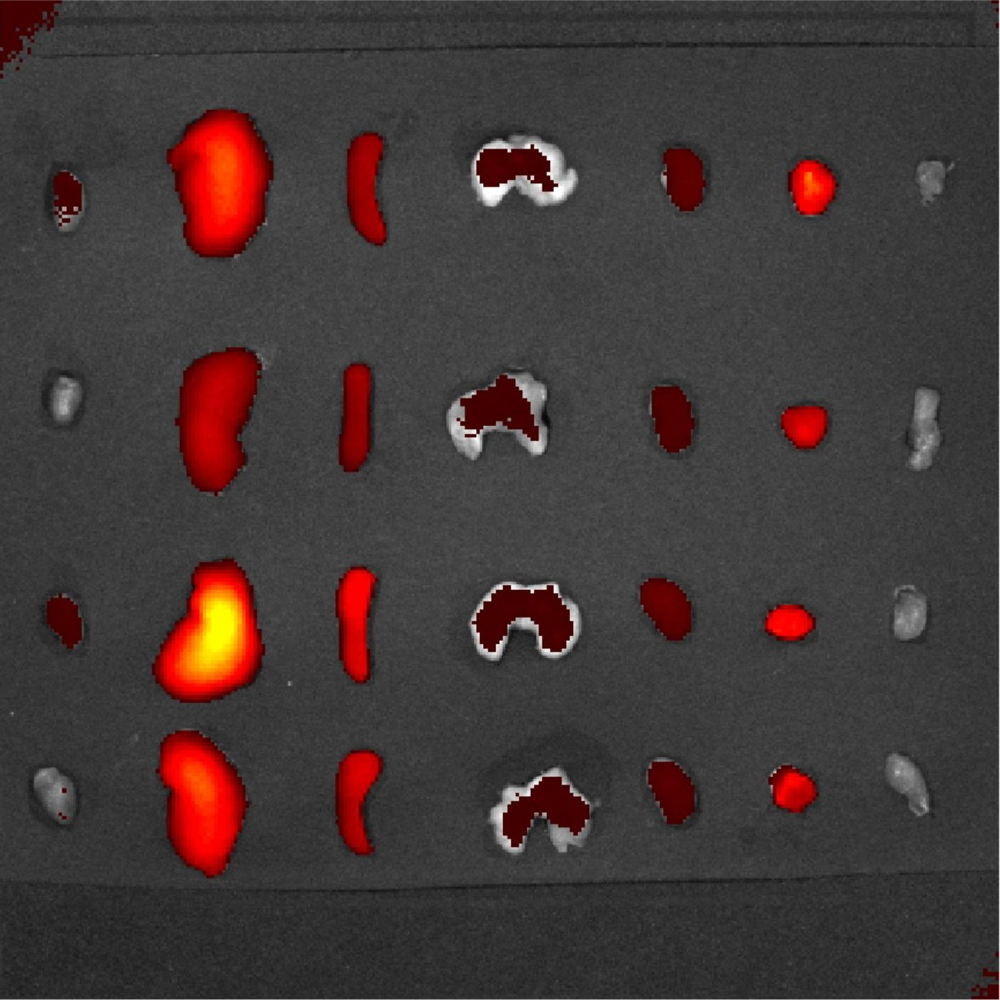
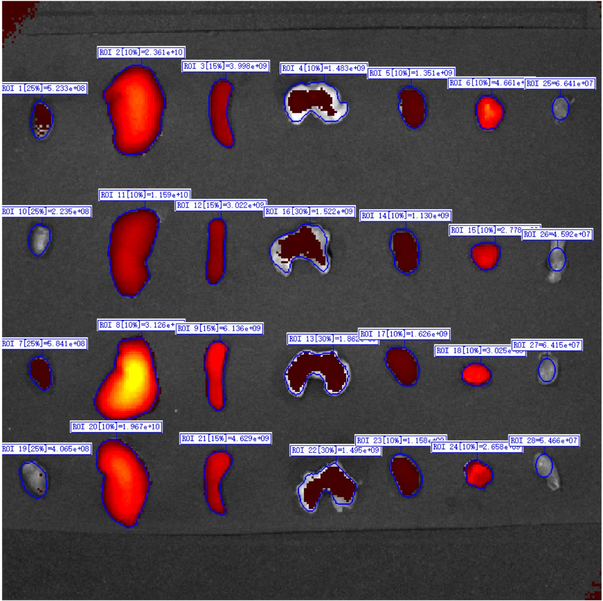
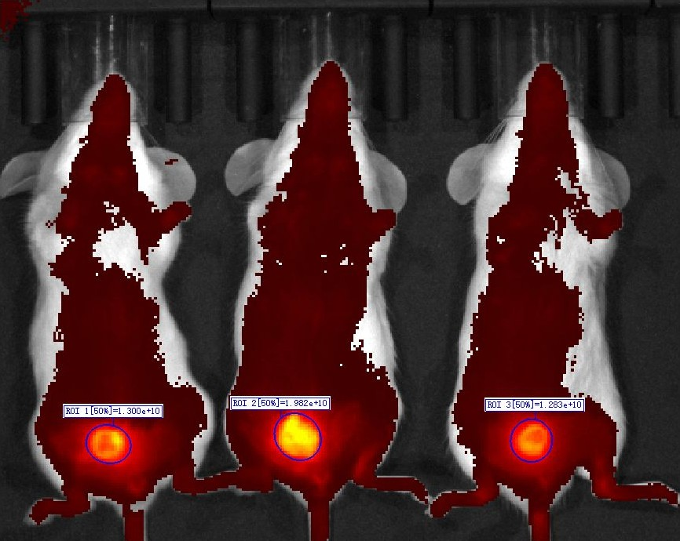
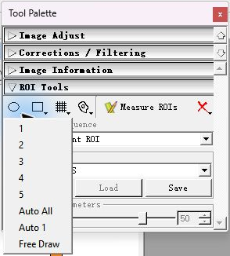
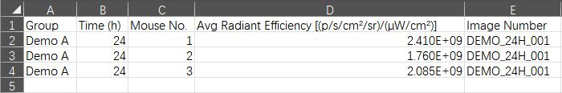

# Auto Living Image Skill

[English](README.md) · 简体中文

这是 **Codex** 和 **Claude Code** 共用的技能，用于在 Living Image（IVIS）桌面软件中测量 ROI 并把结果汇总到 Excel。支持离体脏器和活体肿瘤 ROI，也可选导出 GraphPad Prism XY 宽表。桌面流程在 Windows 的 Living Image 4.3.1 上做过操作验证。

## 流程示例

### 1. 离体脏器定量

**确认样本排布 → 用不规则 Auto 1 圈选器官 → 在 ROI Measurements 中匹配数值 → 按每只鼠、每种组织一行写入 Excel 并核对**

| 未圈选的荧光原图 | 此前完成的 ROI 叠加图 |
| --- | --- |
|  |  |

右图展示同一次 48 h 采集的 **4 只小鼠、28 个 ROI**。每行来自一只鼠，从左到右依次是心、肝、脾、肺、肾、肿瘤和肌肉。AI 按实际位置核对 ROI，并按组织设置阈值。信号太弱而无法用 Auto 1 时，AI 会请你确认是手动画 ROI 还是将数值留空。[离体脏器 ROI 参数与流程](living-image-roi/references/organ-roi.md)

### 2. 活体肿瘤定量



*真实数据截图，显示三只鼠的肿瘤 ROI。图上标签显示总值。若需要平均值，请读取 ROI Measurements 的 Avg Radiant Efficiency 列。*

| Living Image | Excel |
| --- | --- |
|  |  |
| **ROI Tools → Auto 1** | 使用合成数值的结果表示例 |

## 安装

下载或克隆仓库，将整个 [living-image-roi](living-image-roi/) 文件夹复制到对应客户端的技能目录。

| 客户端 | 用户技能目录 | 调用方式 |
| --- | --- | --- |
| [Codex](https://learn.chatgpt.com/docs/build-skills) | `~/.agents/skills/` | `$living-image-roi` |
| [Claude Code](https://code.claude.com/docs/en/skills) | `~/.claude/skills/` | `/living-image-roi` |

在本地 Windows 会话中运行，并为 AI 提供桌面控制工具。只有使用可选的 Prism 导出时才需要 Python 3 和 `openpyxl`。

## 开始测量

### 你需要打开

1. 打开 **Living Image**，在 **Browser** 里加载待处理的数据集列表。具体哪张图由 AI 按你的要求选择。
2. 打开 **Excel** 和要写入的工作簿，可以是空白表，也可以是已有结果表。如果客户端提示授权，允许 AI 操作这两个应用。

### 你需要告诉 AI

- **测哪一批。** 提供数据集名，或给出组别、时间点和鼠号。说明测肿瘤还是离体脏器。图中顺序有歧义时，告诉 AI 鼠号和器官的位置。
- **按什么条件测。** 如果实验方案有要求，提供曝光图、ROI 方法、阈值和测量指标。新建活体荧光 ROI 时，技能默认用第一张荧光图、50% 阈值的圆形 Auto 1、Binning 2、无平滑，读取 Avg Radiant Efficiency。
- **结果写到哪里。** 工作簿有多个工作表时，指定要追加到哪一张。说明新 ROI 要写回数据集，还是留在界面里供你检查。

> 测量 Demo A 组 48 h 的离体组织 ROI。1–4 号鼠从上到下排列，从左到右是心、肝、脾、肺、肾、肿瘤、肌肉。用示例中的 Auto 1 阈值，需要手动画 ROI 时先问我。读取 ROI Measurements 里的 Avg Radiant Efficiency，将结果追加到已打开的 Excel 的 Sheet1 并保存。ROI 留在 Living Image 里让我检查。

### AI 自动完成

1. **找图。** 在 Browser 中定位数据集，打开对应曝光，并核对图像编号和小鼠顺序。
2. **测量。** 核对已有 ROI，或按要求设置参数、圈选新 ROI。打开 **Measure ROIs**，读取指定指标并对应到每只鼠或每个器官。目标不明确时请你确认。
3. **写表并核对。** 把数值、单位和图像编号追加到指定工作表，和测量表核对后按你的要求保存。

## 导出到 Prism

在仓库根目录运行下列命令，用已保存的活体结果工作簿副本生成 TSV。宽表每行是一个时间点，每组小鼠的重复数据按列排列。把 TSV 粘贴到新工作表的 A1，保存后运行校验。工作表序号从 0 开始。

```sh
python -m pip install openpyxl
python living-image-roi/scripts/wide_table.py build results.xlsx prism.tsv
python living-image-roi/scripts/wide_table.py check results.xlsx --wide-sheet 1
```

## 开源协议

本项目的技能、脚本和文档采用 [GNU General Public License v3.0](LICENSE)。Living Image、Excel 和 GraphPad Prism 是各自独立的软件产品。
